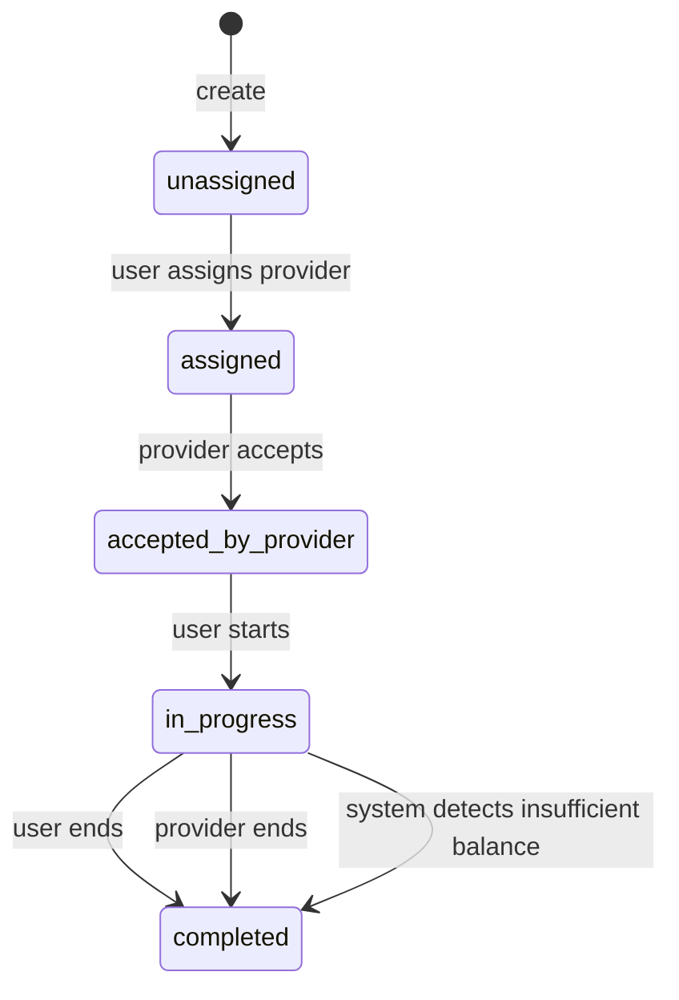
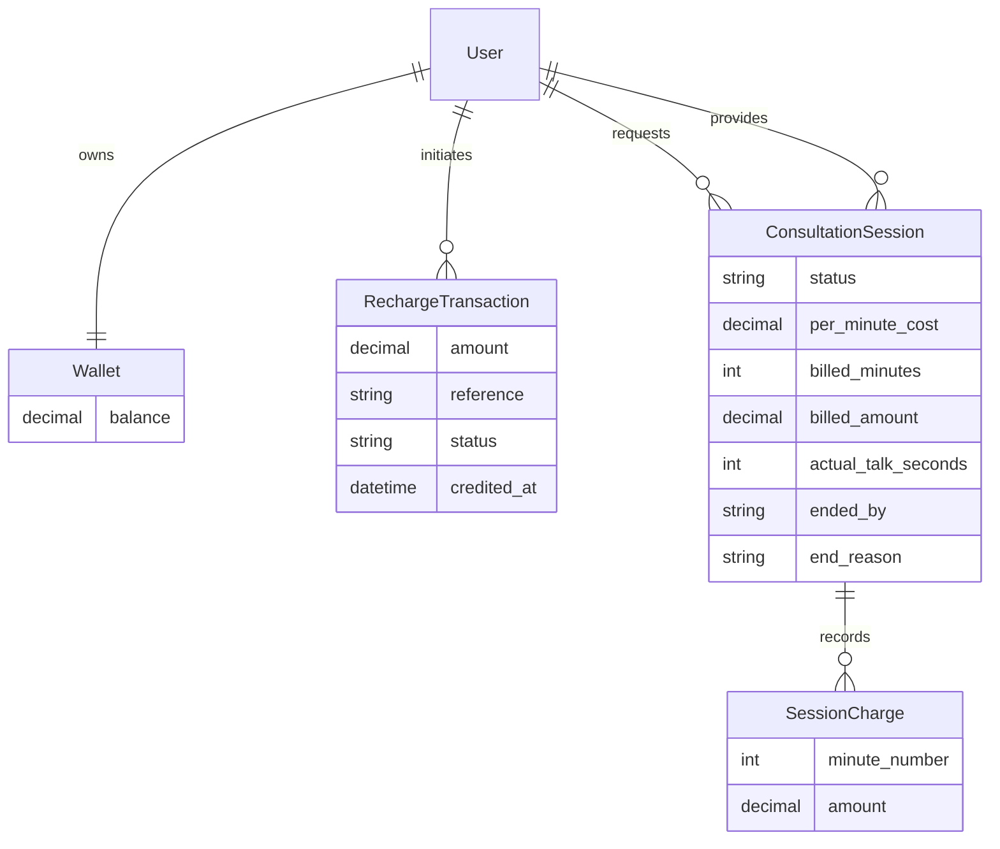

# Wallet-Based Per-Minute Session Billing

A Django REST Framework backend for prepaid one-to-one consultation sessions. It
implements role-aware state transitions, transactional wallet operations,
idempotent mock recharges, and per-minute billing.

## Setup

Python 3.10+ and PostgreSQL are recommended.

```bash
python -m venv .venv
source .venv/Scripts/activate
pip install -r requirements.txt
```

For zero-setup local development, SQLite is used by default:

```bash
python manage.py migrate
python manage.py runserver
```

To use PostgreSQL, start the included database and set the database engine:

```bash
docker compose up -d
export DB_ENGINE=postgresql
python manage.py migrate
python manage.py runserver
```

The default PostgreSQL values are shown in `.env.example`. Override them with
`POSTGRES_DB`, `POSTGRES_USER`, `POSTGRES_PASSWORD`, `POSTGRES_HOST`, and
`POSTGRES_PORT`. In PowerShell, use `$env:DB_ENGINE = "postgresql"` instead of
`export`.

Run the test suite:

```bash
python manage.py test
```

For a complete command-by-command API walkthrough, see
[`CURL_TESTING.md`](CURL_TESTING.md).

## Authentication and API

Authentication uses DRF tokens. Send the returned token as
`Authorization: Token <token>`.

- `POST /api/auth/register/` — register with `username`, `password`, and role
  `USER` or `PROVIDER`
- `POST /api/auth/token/` — obtain a token using `username` and `password`
- `GET /api/auth/me/` — current account
- `GET /api/wallet/` — wallet balance
- `GET|POST /api/wallet/recharges/` — list or initiate a mock recharge
- `POST /api/wallet/recharges/{reference}/callback/` — send `success` or `failed`
- `GET|POST /api/sessions/` — list visible sessions or create one
- `POST /api/sessions/{id}/assign/` — assign `provider_id`
- `POST /api/sessions/{id}/accept/` — assigned provider accepts
- `POST /api/sessions/{id}/start/` — owning user starts
- `POST /api/sessions/{id}/bill/` — bill newly elapsed full minutes
- `POST /api/sessions/{id}/end/` — either participant ends

Example flow:

```bash
curl -X POST http://127.0.0.1:8000/api/auth/register/ \
  -H "Content-Type: application/json" \
  -d '{"username":"alice","password":"StrongPass123!","role":"USER"}'

curl -X POST http://127.0.0.1:8000/api/auth/token/ \
  -H "Content-Type: application/json" \
  -d '{"username":"alice","password":"StrongPass123!"}'

curl -X POST http://127.0.0.1:8000/api/wallet/recharges/ \
  -H "Authorization: Token YOUR_TOKEN" -H "Content-Type: application/json" \
  -d '{"amount":"500.00","reference":"demo-payment-1"}'

curl -X POST http://127.0.0.1:8000/api/wallet/recharges/demo-payment-1/callback/ \
  -H "Content-Type: application/json" -d '{"status":"success"}'
```

## State diagram



## ER diagram



## Implementation decisions

- Money uses fixed-precision decimal fields. Wallet and session rows are locked
  inside database transactions before crediting or charging.
- A session requires at least five times its fixed per-minute rate before start.
  A partial unique database constraint also prevents two active sessions for one
  user.
- Billing charges elapsed **full** minutes. `billed_minutes` tracks the cursor,
  and each minute also has a unique `SessionCharge`, so retries cannot charge the
  same minute twice.
- If multiple minutes are due, affordable minutes are charged in order. When the
  next due minute is unaffordable, the session completes with
  `ended_by=system`, reason `Insufficient balance`, and a nonnegative wallet.
- Actual elapsed talk seconds are stored separately from billed full minutes.
- Recharge references are unique. Terminal callbacks are idempotent, and a
  successful recharge has a persisted `credited_at` marker.
- The mock callback is intentionally unauthenticated to model a payment gateway
  webhook. A real integration should verify gateway signatures.
